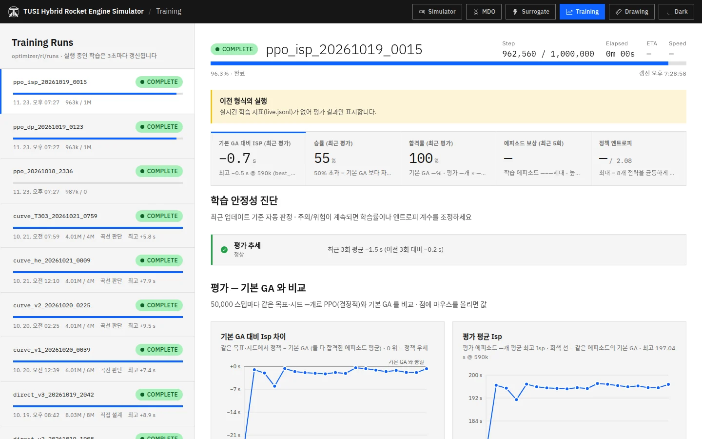
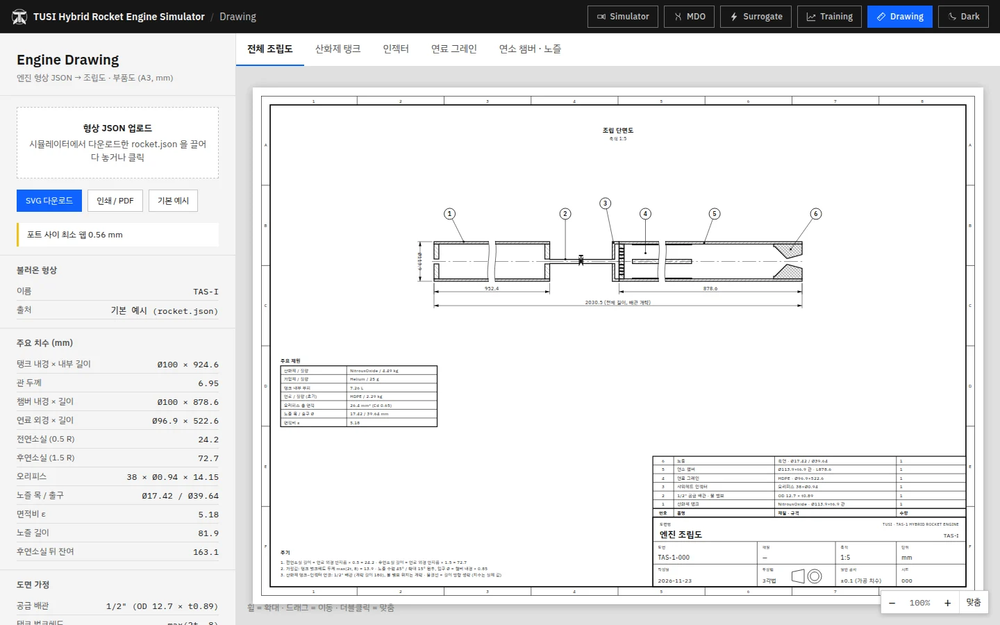
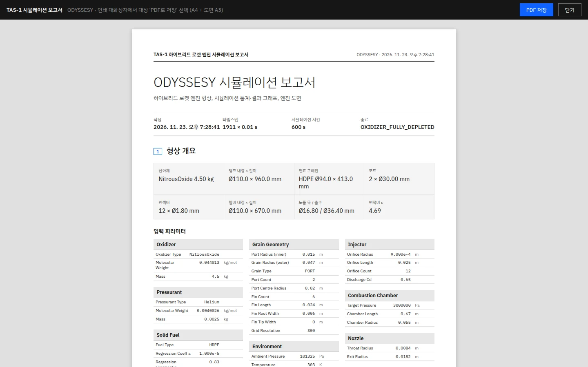

# TAS-1

**하이브리드 로켓 엔진 시뮬레이션 · 설계 최적화 · AI 대리모델 통합 웹 애플리케이션**

TAS-1은 산화제 탱크부터 인젝터, 고체 연료 그레인, 연소실, 노즐까지 연결해 엔진의 시간별 성능을 계산하고, 설계 탐색과 결과 분석을 하나의 웹 화면에서 수행하는 프로젝트입니다. 화면에는 **TUSI Hybrid Rocket Engine Simulator**라는 이름도 사용됩니다.


## 개발 배경과 목표

하이브리드 로켓 엔진은 탱크 압력과 산화제 유량, 연료의 연소 면적이 시간에 따라 함께 변합니다. 하나의 형상에 대한 성능 계산뿐 아니라, 목표 성능을 만족하는 형상을 찾기 위한 반복 해석도 필요합니다.

TAS-1은 **물리 기반 내탄도 해석과 AI 설계 탐색을 연결해 반복 설계를 자동화**하는 것을 목표로 개발했습니다. 설계 입력부터 성능 곡선 확인, 후보 탐색, 도면·보고서 출력까지 같은 환경에서 수행하여 대학 로켓 동아리와 연구실의 초기 설계·교육·타당성 검토에 활용할 수 있도록 구성했습니다.

경희대학교 로켓 동아리 **TUSI**에서 개발했으며, 개발자는 **이종원**입니다.

## 해석 방식

| 구성 요소 | 해석 내용 |
|---|---|
| 산화제 탱크 | N₂O 액체·증기와 헬륨 가압 조건에서 블로우다운에 따른 압력·온도·잔여량 변화 |
| 인젝터 | NHNE 2상 유동 모델을 이용한 산화제 유량 계산 |
| 연료 그레인 | 산화제 질량 유속에 따른 후퇴율과 Level-set 기반 단면 변화 계산 |
| 연소실 | NASA CEA / RocketCEA를 이용한 연소 평형 및 연소실 성능 계산 |
| 노즐 | 팽창에 따른 배기·추력 성능과 노즐 삭마 모델 |
| 설계 탐색 | 대리모델로 후보를 빠르게 평가하고 GA·PPO로 탐색한 뒤 core 해석으로 검증 |

계산 흐름은 **형상·조건 입력 → 시간 영역 해석 → 성능·제약 평가 → 설계 탐색 → 후보 검증 → 도면·보고서**로 이어집니다.

## 주요 기능

| 기능 | 설명 |
|---|---|
| 엔진 시뮬레이션 | CoolProp 물성과 RocketCEA 연소 계산을 이용한 탱크·연소실·노즐 성능 해석 |
| 결과 분석 | 압력·온도·추력 등 시계열, 통계, 그레인 형상과 탱크 설계 확인 |
| 설계 데이터 관리 | JSON 설정 가져오기·내보내기, CSV 결과 다운로드, 배치 실험 |
| 다분야 설계 최적화(MDO) | 목표 총 임펄스·추력과 제약 조건에 따른 GA 설계 탐색 |
| AI 대리모델 | 요약 성능 및 연소 시계열 예측, 대리모델을 이용한 빠른 후보 평가 |
| 강화학습 | PPO 기반 GA 전략 선택·직접 설계·곡선 판단 코드와 학습 모니터 |
| 도면·보고서 | 엔진 도면과 시뮬레이션 보고서 화면 |
| Launch League | 사전 계산한 엔진 결과표를 사용하는 별도 체험 게임 |

강화학습 코드는 세 가지 방식을 제공하며, 이 저장소의 배포 가중치는 현재 설정과 호환되는 **곡선 판단 정책**입니다. 대리모델 기반 최적화는 최종 후보의 core 시뮬레이션 검증과 함께 사용합니다.

## 지원 조건

| 항목 | 지원 범위 |
|---|---|
| 산화제 | `NitrousOxide` — 아산화질소(N₂O) |
| 연료 CEA 카드 | `PARAFFIN`, `HTPB`, `HDPE`, `ABS` |
| 가압제 | `Helium` 기준. 질량을 0으로 설정하면 N₂O 자가가압 조건 |
| 그레인 | `PORT` 원형 단일·다공 포트, `FIN` 멀티핀, `FINOCYL` 피노실 |

연료 이름은 CEA 연소 계산에 사용됩니다. 연료별 **밀도와 후퇴율 계수 `fuel_a`, `fuel_n`은 별도로 입력**해야 합니다. 후퇴율 관계는 `r_dot = a × G_ox^n`이며, 문헌의 계수는 입력 단위에 맞게 환산해야 합니다. 산화제 모델과 CEA 설정은 N₂O 기준입니다.

MDO와 배포 AI 모델은 시뮬레이터 전체 입력 범위보다 적용 조건이 좁습니다. 현재 최적화 고정 조건은 **N₂O + HDPE, 원형 포트, 초기 온도 303 K, 연료 밀도 950 kg/m³, a = 1×10⁻⁵, n = 0.83**이며 `optimizer/fixedvalue.json`에서 확인할 수 있습니다. 조건을 변경하면 기존 정책의 호환성과 대리모델의 학습 범위를 함께 확인해야 합니다.

## 화면

### 설계 최적화


### AI 대리모델


### 학습 모니터


### 도면 및 보고서



추가 화면: [성능 그래프](docs/screenshots/charts2.webp) · [통계표](docs/screenshots/tab0.webp) · [그레인](docs/screenshots/tab1.webp). 스크린샷은 기존 실행 결과를 보여주며, 새로 설치한 환경에는 실험·학습 이력이 포함되지 않습니다.

## 사용 흐름

### 1. 엔진 설정과 시뮬레이션

1. Simulator 왼쪽 패널에서 산화제·가압제·연료·그레인·탱크·인젝터·연소실·노즐과 계산 조건을 설정합니다.
2. **Run Simulation**으로 계산하고 완료 메시지, 종료 사유, 인젝터 차압 판정을 확인합니다.
3. **Performance Charts**, **Statistics Table**, **Grain Visualization**, **Tank Design**에서 성능 시계열·통계·연소 단면·탱크 설계를 확인합니다.
4. **Save JSON / Load JSON**으로 형상을 관리하고, **CSV**와 **Report**로 결과를 저장합니다.

시뮬레이션 실행 시 입력 형상이 `rocket.json`에 저장되어 다음 실행의 기본값이 됩니다. 여러 형상을 보관하려면 JSON을 별도로 저장하세요. 현재 저장소의 기본 형상은 `rocket.json`을 기준으로 하며, Windows 사용 가이드의 `SAMPLE-1` 예시와 다릅니다.

주요 출력은 탱크·연소실 압력과 온도, 추력, 배기 속도, 비추력(Isp), 산화제·연료 유량, O/F, 후퇴율, 특성속도(c*), 추력 계수 및 인젝터 차압입니다.

| 종료 코드 | 의미 |
|---|---|
| `OXIDIZER_FULLY_DEPLETED` | 액체·기체 산화제 소진 |
| `FUEL_DEPLETED` | 연료 소진 |
| `CHAMBER_PRESSURE_BELOW_AMBIENT` | 연소실 압력이 대기압 아래로 하락 |
| `TIME_LIMIT_REACHED` | 설정한 최대 계산 시간 도달 |

### 2. 배치 실험

`/experiment`에서 최상위 키가 케이스 이름인 형상 JSON을 올려 여러 조건을 병렬 계산합니다. 병렬 워커 수와 진행 상황을 확인하고 케이스별 CSV 또는 전체 ZIP을 받을 수 있습니다. 상단 메뉴에 항목이 보이지 않으면 주소로 직접 접속합니다.

### 3. 목표 성능에 맞는 설계 탐색

MDO에서 **목표 총 임펄스(N·s), 평균 추력(N), 허용 오차**를 설정하면, 해당 조건과 기하·압력·구조 제약을 만족하면서 비추력이 높은 형상을 탐색합니다. 개체 수·세대 수·시드와 파이프 후보를 설정하고 평가기로 core 또는 Surrogate를 선택합니다.

최적화 방식은 기본 GA, AI 제어 GA, AI 직접 설계, AI 곡선 판단으로 구성됩니다. 호환되는 모델이 없는 방식은 사용할 수 없습니다. 결과는 **Open in Simulator**로 넘기거나 JSON으로 내려받아 확인합니다. 파이프 DB는 실제 사용할 규격으로 검토·수정해야 합니다.

### 4. 대리모델로 빠르게 비교

Surrogate 화면에서 형상을 바꾸면 신경망 앙상블이 비추력·총 임펄스·평균 추력·연소 시간·최대 연소압·최소 인젝터 차압을 예측합니다. **앙상블 2σ** 표시와 학습 범위 이탈 여부를 함께 확인하고, 선택한 후보는 Simulator에서 core 계산으로 검증합니다.

### 5. 도면과 보고서

Drawing에 형상 JSON을 불러오면 전체 조립도와 탱크·인젝터·그레인·연소실·노즐 부품도를 확인할 수 있습니다. 도면은 **A3·mm 기준 SVG 또는 인쇄/PDF**로 출력하며, 보고서는 형상 개요·통계·그래프·도면을 정리합니다. JSON에 없는 배관·벌크헤드·노즐 각도 등의 치수에는 도면에 명시된 가정값을 사용합니다.

### 입력 단위

| 물리량 | Simulator · JSON · Experiment | Surrogate | Drawing |
|---|---|---|---|
| 길이·반지름 | m | mm | mm |
| 압력 | Pa | MPa | 도면 표기 기준 |
| 온도 | K | K | — |
| 질량 | kg | kg | kg |
| 분자량 | kg/mol | — | — |
| 밀도 | kg/m³ | — | — |
| 추력·총 임펄스 | N · N·s | N · N·s | N · N·s |
| 시간·비추력 | s | s | s |

예를 들어 Simulator에서 **45 mm는 `0.045`, 3 MPa는 `3000000`, 30 ℃는 `303.15`**로 입력합니다. 반지름 입력칸에 지름을 넣지 않도록 확인하세요.

## 설치 및 실행

Python **3.11** 환경을 기준으로 합니다. Linux에서는 RocketCEA 빌드용 Fortran 컴파일러가 필요할 수 있습니다.

```bash
git clone https://github.com/remontree/TAS-1.git
cd TAS-1

# Ubuntu / Debian 빌드 도구
sudo apt-get update
sudo apt-get install -y gfortran build-essential python3-dev pkg-config python3-venv

python3.11 -m venv .venv
source .venv/bin/activate
python -m pip install --upgrade pip
python -m pip install -r requirements.txt

LOCAL_MODE=1 HOST=127.0.0.1 PORT=10000 python flask_app.py
```

브라우저에서 **http://127.0.0.1:10000** 에 접속합니다. Linux 데스크톱에서는 `uv`, `curl`과 브라우저 실행 도구가 준비된 경우 `./start_local.sh`로 실행하고 `./stop_local.sh`로 종료할 수도 있습니다.

| 경로 | 화면 |
|---|---|
| `/` | 엔진 시뮬레이터 |
| `/experiment` | 배치 실험 |
| `/mdo` | 설계 최적화 |
| `/surrogate` | 대리모델 |
| `/training` | 학습 모니터 |
| `/drawing` | 도면 |
| `/report` | 보고서 |

기본 엔진 설정은 `rocket.json`, 연료 CEA 카드는 `fuel_cea_card.json`, 최적화의 고정 조건과 파이프 규격은 `optimizer/fixedvalue.json`, `optimizer/PIPEDB.csv`에 있습니다. 시뮬레이션 결과와 실험 파일은 실행 중 생성됩니다.

### Docker

```bash
docker build -t tas-1 .
docker run --rm -p 127.0.0.1:10000:10000 -e LOCAL_MODE=1 tas-1
```

### 로그인 모드

`LOCAL_MODE=1`은 로그인 없이 사용하는 로컬 모드입니다. 로그인 모드에서는 `LOCAL_MODE`를 설정하지 않고 `SECRET_KEY`와 `PASSWORD_HASH`(사용할 비밀번호의 SHA-256 해시)를 환경변수로 지정합니다. 저장소에는 기존 운영 비밀번호 해시를 포함하지 않습니다. 서버는 `.env`를 자동으로 읽지 않으므로 환경변수는 실행 환경에서 전달해야 합니다.

## 포함 파일과 모델

```text
TAS-1/
├── flask_app.py                 # Flask 진입점
├── core/                        # 물리 시뮬레이션
├── static/                      # 웹 화면·로컬 JS·브라우저 대리모델
├── optimizer/
│   ├── GA.py                    # 유전 알고리즘
│   ├── constrain.py             # 설계 제약
│   ├── PIPEDB.csv               # 파이프 규격
│   ├── fixedvalue.json          # 최적화 고정 조건
│   └── rl/                     # 대리모델·PPO 코드와 배포 가중치
├── surrogate/                   # 브라우저 모델 데이터 생성·학습 코드
├── game/                        # 별도 체험 게임
├── docs/screenshots/            # 실제 프로그램 화면
├── rocket.json                  # 기본 엔진 설정
└── fuel_cea_card.json            # 연료 정의
```

현재 추론에 필요한 대리모델 가중치와 메타데이터, 호환되는 곡선 기반 PPO 정책의 best 가중치 및 설정을 포함합니다. 상세 목록은 [배포 모델](docs/MODELS.md)을 참고하세요. 가중치는 일반 Git 파일로 포함되므로 별도 다운로드 과정 없이 복제할 수 있습니다.

실험 CSV, 학습 원본·teacher 데이터, TensorBoard, 이전 모델, 가상환경, 로그, 백업, 게임 참가자 DB·인증키·인증서는 제외합니다. 게임 LUT 생성에 필요한 기준 설계 JSON 한 개는 포함합니다. 재학습 시에는 학습 데이터를 별도로 생성해야 합니다.

## 기술 구성

- **Backend / 해석:** Python, Flask, NumPy, pandas, SciPy, CoolProp, RocketCEA
- **AI / 최적화:** PyTorch, Stable-Baselines3 PPO, 자체 GA 및 제약 검사
- **Frontend:** React 18, Recharts, IBM Carbon 스타일 UI
- **별도 게임:** Flask, Gunicorn, Node.js 기반 비행 점수 재계산

Python 의존성은 `requirements.txt`로 관리합니다. 일부 화면은 외부 폰트·CDN을 사용하므로 완전한 오프라인 실행을 보장하지 않습니다.

## 문제 해결

| 증상 | 확인할 내용 |
|---|---|
| CEA 카드 관련 오류 | 연료 이름을 `PARAFFIN`, `HTPB`, `HDPE`, `ABS` 중 정확한 대문자 표기로 입력했는지 확인 |
| 물질 이름 오류 | CoolProp 이름인 `NitrousOxide`, `Helium` 표기 확인 |
| 결과 크기가 예상과 다름 | m/mm, Pa/MPa, K/℃ 및 반지름/지름 혼동 확인 |
| 연소 중 시간 제한으로 종료 | `simt`를 늘려 재실행 |
| 계산이 오래 걸림 | 시간 간격 `dt`, 단면 격자 `grid_size`, 병렬 워커 수 확인. MDO에서는 Surrogate 평가 사용 가능 |
| AI 정책이 목록에 없음 | 고정 온도·설계 변수·관측 규격과 배포 모델의 호환성 확인 |

## 문서 기준과 적용 범위

이 README는 **「TAS-1 사용 가이드」(2026-11, Windows 실행판)**와 **2026 AI·SW 페스티벌 TAS-I 소개 자료**를 참고하고, 현재 저장소의 코드·설정과 대조해 작성했습니다. Windows 배포판의 `TAS-1.exe`, 내장 Python, 트레이 종료, 자동 포트 선택 기능은 이 소스 저장소에 포함되어 있지 않습니다.

페스티벌 소개 자료에는 시뮬레이션 오차 약 4%, AI 비추력 예측 MAE 3.14 s, 최적 설계 평균 비추력 208 s가 성과로 제시되어 있습니다. 이는 소개 자료에 기재된 평가 결과이며, 현재 배포 가중치에 대해 이 저장소에서 재검증한 수치는 아닙니다. 원본 실험 데이터와 전체 평가 조건은 이 저장소에 포함하지 않습니다.

시뮬레이션과 자동 생성 도면은 초기 설계 검토를 위한 자료입니다. 실제 제작·시험에는 별도 해석과 시험 검증이 필요합니다.
