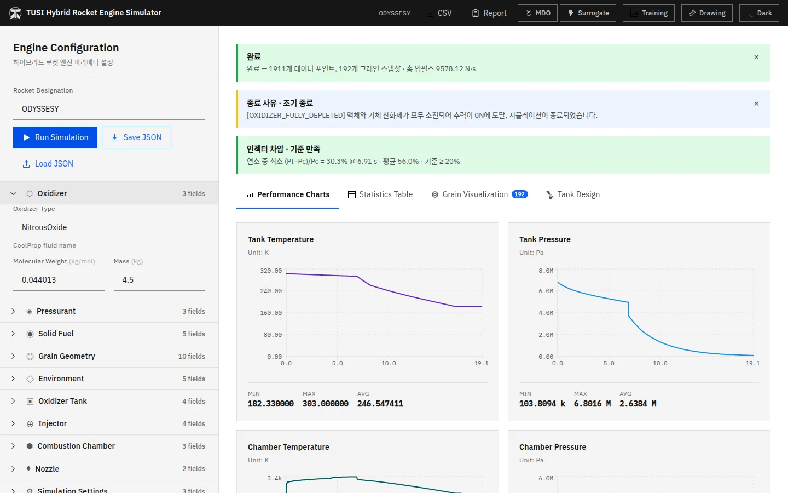
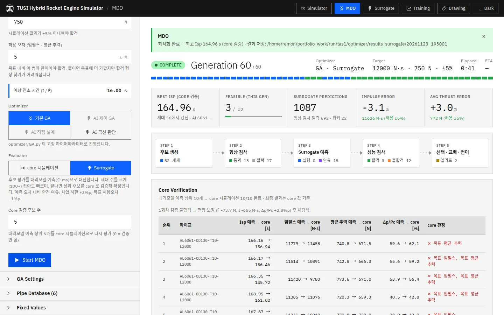
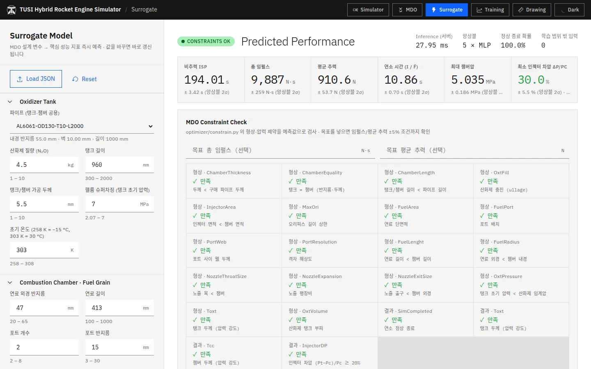

# TAS-1

**하이브리드 로켓 엔진 시뮬레이션 · 설계 최적화 · AI 대리모델 통합 웹 애플리케이션**

TAS-1은 산화제 탱크부터 인젝터, 고체 연료 그레인, 연소실, 노즐까지 연결해 엔진의 시간별 성능을 계산하고, 설계 탐색과 결과 분석을 하나의 웹 화면에서 수행하는 프로젝트입니다. 화면에는 **TUSI Hybrid Rocket Engine Simulator**라는 이름도 사용됩니다.



## 주요 기능

| 기능 | 설명 |
|---|---|
| 엔진 시뮬레이션 | CoolProp 물성과 RocketCEA 연소 계산을 이용한 탱크·연소실·노즐 성능 해석 |
| 결과 분석 | 압력·온도·추력 등 시계열, 통계, 그레인 형상과 탱크 설계 확인 |
| 설계 데이터 관리 | JSON 설정 가져오기·내보내기, CSV 결과 다운로드, 배치 실험 |
| 다분야 설계 최적화(MDO) | 목표 총 임펄스·추력과 제약 조건에 따른 GA 설계 탐색 |
| AI 대리모델 | 요약 성능 및 연소 시계열 예측, 대리모델을 이용한 빠른 후보 평가 |
| 강화학습 | PPO 기반 GA 전략 선택·직접 설계·곡선 판단 코드와 학습 모니터 |
| 도면·보고서 | 엔진 도면과 시뮬레이션 보고서 화면 |
| Launch League | 사전 계산한 엔진 결과표를 사용하는 별도 체험 게임 |

강화학습 코드는 세 가지 방식을 제공하며, 이 저장소의 배포 가중치는 현재 설정과 호환되는 **곡선 판단 정책**입니다. 대리모델 기반 최적화는 최종 후보의 core 시뮬레이션 검증과 함께 사용합니다.

## 화면

### 설계 최적화


### AI 대리모델


### 학습 모니터


### 도면 및 보고서


추가 화면: [성능 그래프](docs/screenshots/charts2.webp) · [통계표](docs/screenshots/tab0.webp) · [그레인](docs/screenshots/tab1.webp). 스크린샷은 기존 실행 결과를 보여주며, 새로 설치한 환경에는 실험·학습 이력이 포함되지 않습니다.

## 설치 및 실행

Python **3.11** 환경을 기준으로 합니다. Linux에서는 RocketCEA 빌드용 Fortran 컴파일러가 필요할 수 있습니다.

```bash
git clone https://github.com/remontree/TAS-1.git
cd TAS-1

# Ubuntu / Debian 빌드 도구
sudo apt-get update
sudo apt-get install -y gfortran build-essential python3-dev pkg-config python3-venv

python3.11 -m venv .venv
source .venv/bin/activate
python -m pip install --upgrade pip
python -m pip install -r requirements.txt

LOCAL_MODE=1 HOST=127.0.0.1 PORT=10000 python flask_app.py
```

브라우저에서 **http://127.0.0.1:10000** 에 접속합니다. Linux 데스크톱에서는 `uv`, `curl`과 브라우저 실행 도구가 준비된 경우 `./start_local.sh`로 실행하고 `./stop_local.sh`로 종료할 수도 있습니다.

| 경로 | 화면 |
|---|---|
| `/` | 엔진 시뮬레이터 |
| `/experiment` | 배치 실험 |
| `/mdo` | 설계 최적화 |
| `/surrogate` | 대리모델 |
| `/training` | 학습 모니터 |
| `/drawing` | 도면 |
| `/report` | 보고서 |

기본 엔진 설정은 `rocket.json`, 연료 CEA 카드는 `fuel_cea_card.json`, 최적화의 고정 조건과 파이프 규격은 `optimizer/fixedvalue.json`, `optimizer/PIPEDB.csv`에 있습니다. 시뮬레이션 결과와 실험 파일은 실행 중 생성됩니다.

### Docker

```bash
docker build -t tas-1 .
docker run --rm -p 127.0.0.1:10000:10000 -e LOCAL_MODE=1 tas-1
```

### 로그인 모드

`LOCAL_MODE=1`은 로그인 없이 사용하는 로컬 모드입니다. 로그인 모드에서는 `LOCAL_MODE`를 설정하지 않고 `SECRET_KEY`와 `PASSWORD_HASH`(사용할 비밀번호의 SHA-256 해시)를 환경변수로 지정합니다. 저장소에는 기존 운영 비밀번호 해시를 포함하지 않습니다. 서버는 `.env`를 자동으로 읽지 않으므로 환경변수는 실행 환경에서 전달해야 합니다.

## 포함 파일과 모델

```text
TAS-1/
├── flask_app.py                 # Flask 진입점
├── core/                        # 물리 시뮬레이션
├── static/                      # 웹 화면·로컬 JS·브라우저 대리모델
├── optimizer/
│   ├── GA.py                    # 유전 알고리즘
│   ├── constrain.py             # 설계 제약
│   ├── PIPEDB.csv               # 파이프 규격
│   ├── fixedvalue.json          # 최적화 고정 조건
│   └── rl/                     # 대리모델·PPO 코드와 배포 가중치
├── surrogate/                   # 브라우저 모델 데이터 생성·학습 코드
├── game/                        # 별도 체험 게임
├── docs/screenshots/            # 실제 프로그램 화면
├── rocket.json                  # 기본 엔진 설정
└── fuel_cea_card.json            # 연료 정의
```

현재 추론에 필요한 대리모델 가중치와 메타데이터, 호환되는 곡선 기반 PPO 정책의 best 가중치 및 설정을 포함합니다. 상세 목록은 [배포 모델](docs/MODELS.md)을 참고하세요. 가중치는 일반 Git 파일로 포함되므로 별도 다운로드 과정 없이 복제할 수 있습니다.

실험 CSV, 학습 원본·teacher 데이터, TensorBoard, 이전 모델, 가상환경, 로그, 백업, 게임 참가자 DB·인증키·인증서는 제외합니다. 게임 LUT 생성에 필요한 기준 설계 JSON 한 개는 포함합니다. 재학습 시에는 학습 데이터를 별도로 생성해야 합니다.

## 기술 구성

- **Backend / 해석:** Python, Flask, NumPy, pandas, SciPy, CoolProp, RocketCEA
- **AI / 최적화:** PyTorch, Stable-Baselines3 PPO, 자체 GA 및 제약 검사
- **Frontend:** React 18, Recharts, IBM Carbon 스타일 UI
- **별도 게임:** Flask, Gunicorn, Node.js 기반 비행 점수 재계산

Python 의존성은 `requirements.txt`로 관리합니다. 일부 화면은 외부 폰트·CDN을 사용하므로 완전한 오프라인 실행을 보장하지 않습니다.
